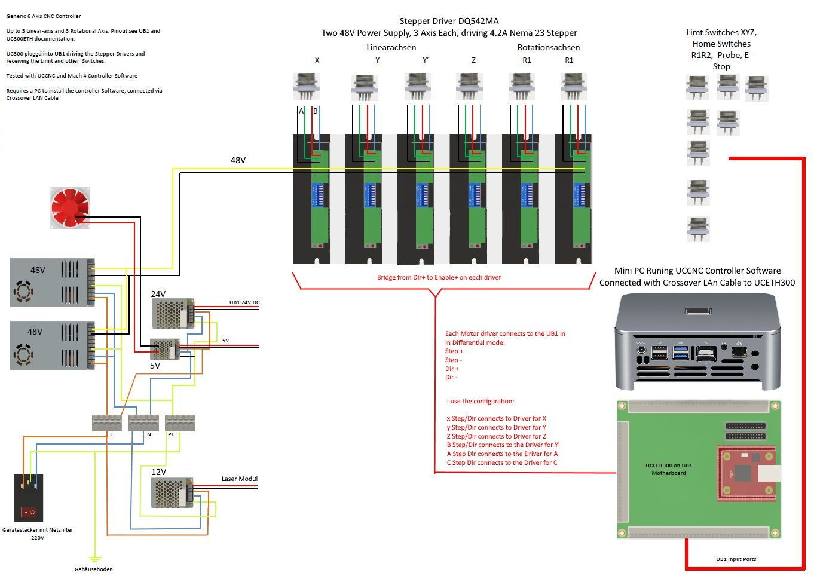
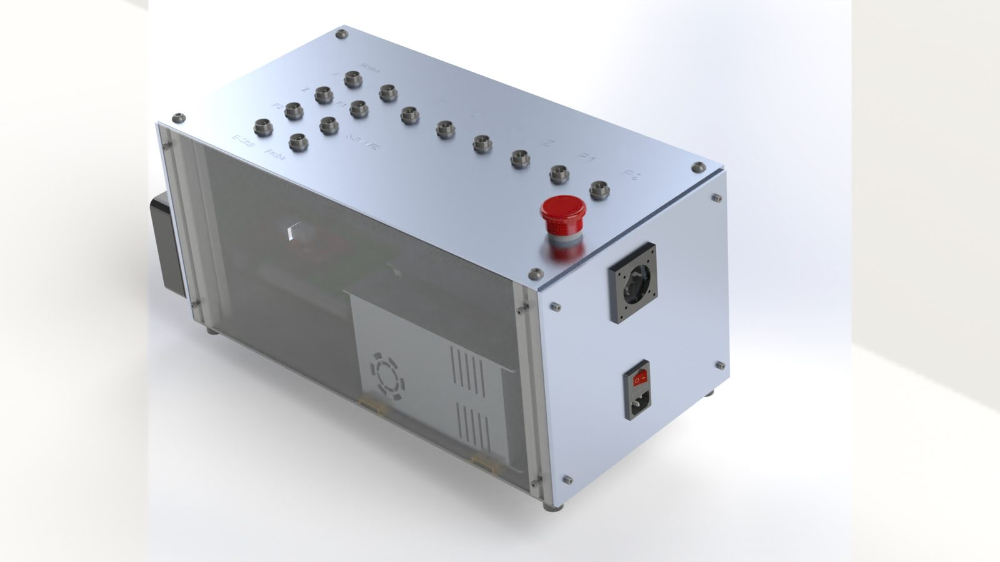
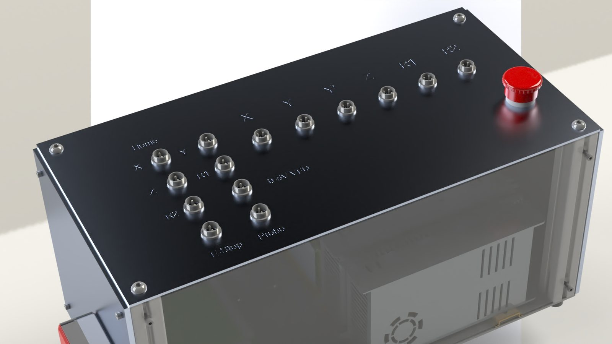
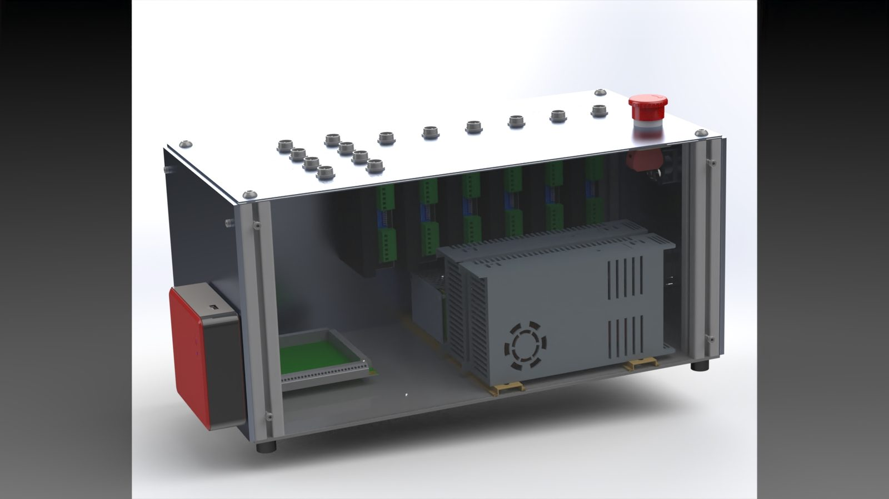
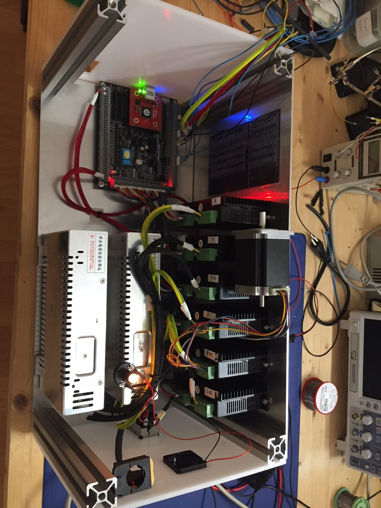
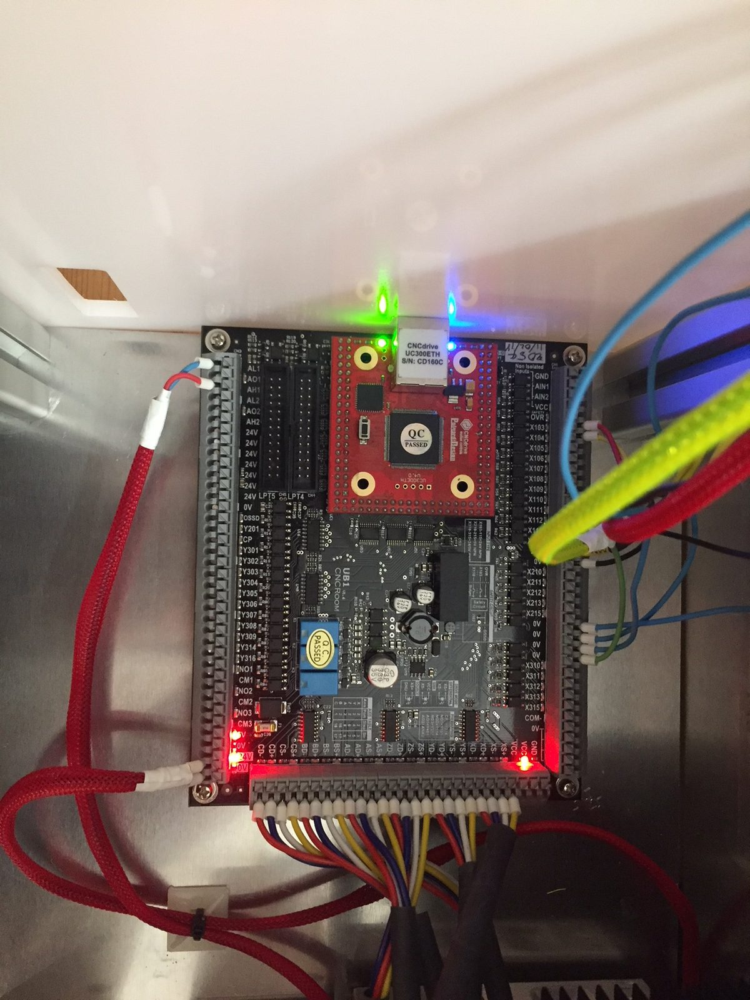
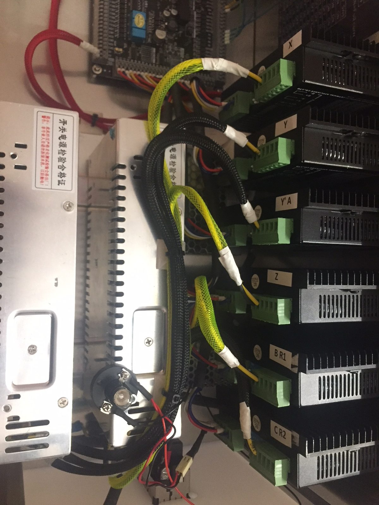
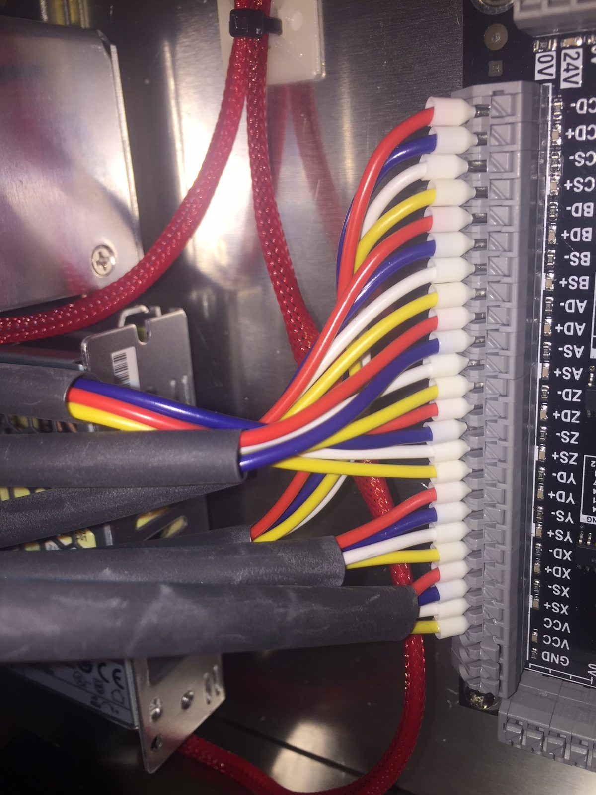
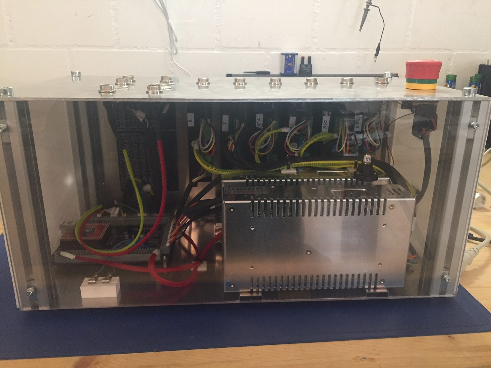

# 6-Axis CNC Controller

*Controller for up to 6 stepper motors based on UC300ETH and UB1 – for 4- and 5-axis operation.*

Source: [6-Achsen-CNC-Steuerung (masdrive.ch, German)](https://masdrive.ch/myprojects/projects/6-axis-controller/) · CAD: [Generic 6 Axis CNC / Robotics Controller (GrabCAD)](https://grabcad.com/library/generic-6-axis-cnc-robotics-controller-1) · Schematic: [electronics/](../../electronics/README.md)

This controller drives up to six stepper motors and is the electronic basis for multi-axis operation of my [self-built CNC router](../01-cnc-router/README.md). It is designed for three linear axes (X, Y, Z) and three rotary axes (A, B, C) – in my machine specifically as X, Y, Y′, Z, A, C, i.e. with two synchronously running Y-axes and two rotary axes.

The reason for the new build was extending the router beyond three axes. A classic 3-axis controller quickly reaches its limits here: axes are missing, the signal quality is not sufficient for fast step rates, and simultaneous multi-axis machining needs a real motion controller instead of a parallel-port solution.

## Technical data

| Item | Value |
|---|---|
| Motion controller | UC300ETH |
| Mainboard | UB1 |
| Max. axes | 6 stepper motors, max. 4.2 A each |
| Typical configuration | X, Y, Y′, Z, A, C (5-axis CNC) |
| Software | UCCNC / Mach4 |

## Why UC300ETH and UB1

The choice fell on the UC300ETH motion controller together with the UB1 mainboard. Three points were decisive:

- **Ethernet instead of USB or parallel port.** The connection to the PC is less sensitive to the electrical noise that is unavoidable in a workshop with a spindle and stepper drivers.
- **Six axes out of the box.** No retrofitting, no extra cards – the extension to 5-axis operation was planned from the start.
- **The UB1 mainboard takes care of the wiring.** Inputs and outputs, limit switches, relays and spindle control sit on one board with defined terminals instead of ending up as loose wiring in the cabinet.

The hardware is driven either by UCCNC or Mach4. UCCNC is tailored to the UC300 and is the simpler option for home use.

## Construction

All electronics are housed in a control cabinet: motion controller and mainboard, the stepper drivers for the individual axes, power supply, emergency stop and the connections for limit switches and spindle. Each axis may draw up to 4.2 A.

I paid particular attention to a clean separation of power and signal wiring. With stepper systems this is not a cosmetic issue: coupled-in noise leads to lost steps, and lost steps are often only noticed on the scrapped workpiece. Shielded motor cables with the shield connected on one side and separate cable routes have proven themselves.

The pictures below show the build in several stages up to the current version V3.

## Axis configuration

The six channels are assigned as follows in my machine:

- **X, Y, Y′, Z** – the linear axes of the gantry, with the two Y drives working synchronously on the gantry beam. This avoids racking of the gantry but requires clean homing of both sides.
- **A and C** – the two rotary axes of the [AC rotary table](../04-ac-bc-rotary-table/README.md). Alternatively, the [4th CNC axis](../03-4th-axis/README.md) can be connected here as a single rotary axis.

This way a single controller covers both everyday 3-axis work and 4- and 5-axis operation without any rewiring.

## Status and experience

The controller is fully built, tested and has been in use for a long time. UC300ETH and UB1 have proven to be reliable, robust hardware – so far there have been no sporadic dropouts, which otherwise tend to cost the most troubleshooting time with self-built controllers.

## Notes for builders

The control cabinet is tailored to my machine. Motor currents, microstep setting, limit-switch logic, homing and the emergency-stop chain must match your own mechanics.

One point that is often neglected in DIY builds: **the emergency-stop chain must actually cut the power** and must not merely send a software signal to the controller.

The CAD models of the enclosure are available for download on [GrabCAD](https://grabcad.com/library/generic-6-axis-cnc-robotics-controller-1).

## Gallery

| | | |
|---|---|---|
|  |  |  |
| 6-axis CNC controller, finished cabinet version V3 | Cabinet with UC300ETH motion controller and UB1 mainboard | Stepper drivers and power supply in the cabinet |
|  |  |  |
| Interior view of the 6-axis controller | Wiring of the axis connectors on the UB1 mainboard | Separate routing of power and signal lines |
|  |  |  |
| Terminal blocks for limit switches and spindle control | Control cabinet in an intermediate build stage | Wiring of the stepper drivers in detail |

---

*Translated from the German original on [masdrive.ch](https://masdrive.ch/myprojects/projects/6-axis-controller/). Build at your own risk – see [DISCLAIMER](../../DISCLAIMER.md).*
