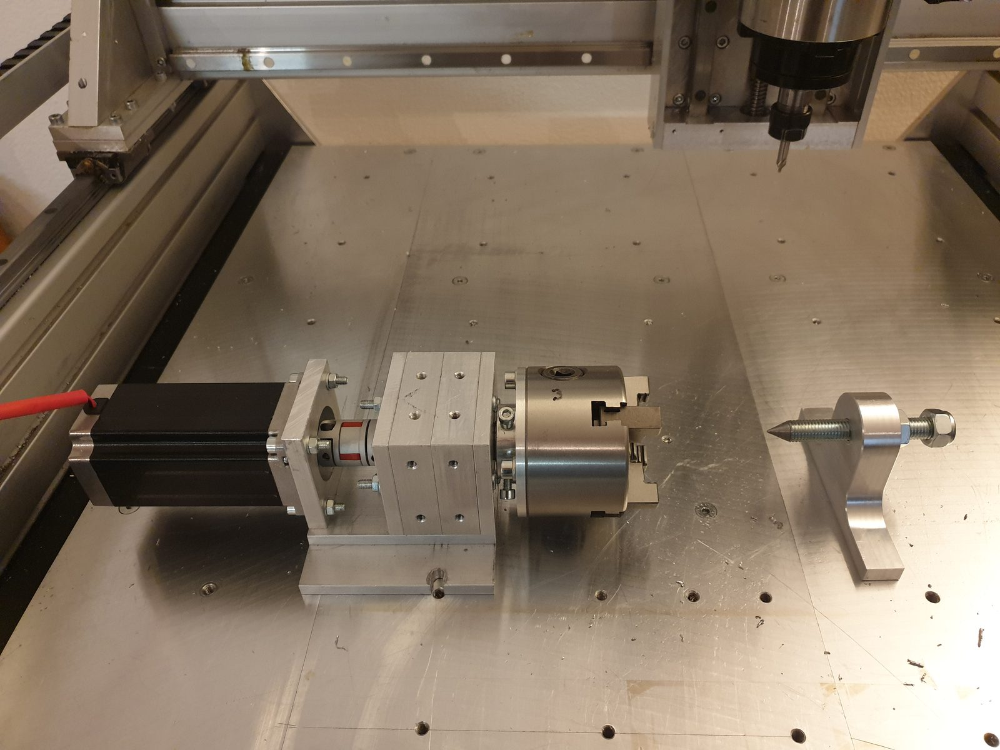
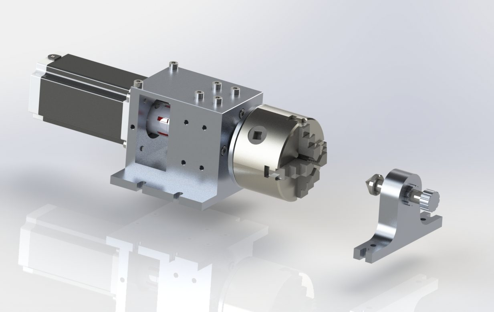
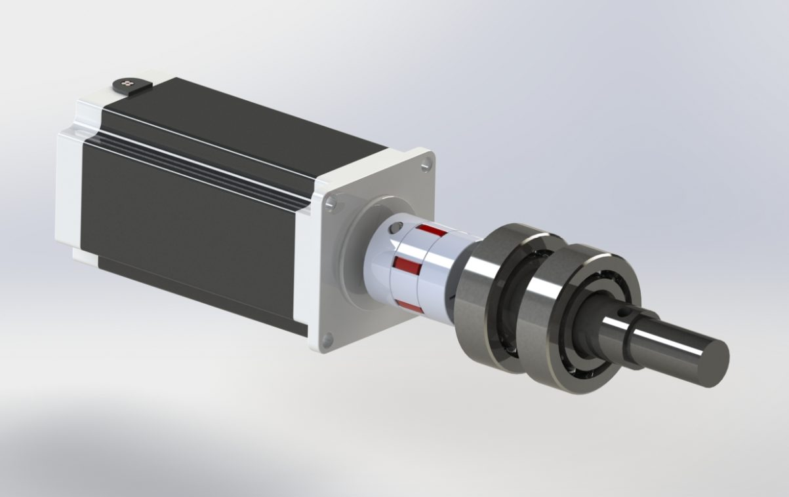

# 4th Axis for a DIY CNC Router

*Rotary and indexing 4th axis (A- or B-axis) with 80 mm chuck – can be retrofitted to any CNC router.*

Source: [4. CNC-Achse (masdrive.ch, German)](https://masdrive.ch/myprojects/projects/4th-cnc-axis/) · CAD: [4th Axis for CNC Router (GrabCAD)](https://grabcad.com/library/4th-axis-for-cnc-router-1)

A fourth axis that can be fitted to practically any CNC router. Depending on its orientation on the machine table it works as an A-axis (rotation about X) or as a B-axis (rotation about Y) and serves both as an indexing device and as a rotary head.

It is particularly well suited for indexed machining. The workpiece can be rotated precisely between operations, so that several sides can be machined without manual re-clamping.

## Technical data

| Item | Value |
|---|---|
| Drive | NEMA 23 stepper motor |
| Chuck | 80 mm, 4-jaw |
| Bearings | 2 angular-contact thrust ball bearings |
| Use | A- or B-axis (about X or Y), indexing or rotary head |

## Construction

The axis is driven by a NEMA 23 stepper motor. The spindle runs in two angular-contact thrust ball bearings; this arrangement takes both radial and axial forces, which matters more when milling against the chuck than when just indexing. At the front sits an 80 mm four-jaw chuck.

The four-jaw chuck was a deliberate choice over a three-jaw chuck: it also clamps square and irregular workpieces, and the jaws can be adjusted individually so that a workpiece can be aligned precisely.

## Typical applications

- Holes and pockets all around cylindrical parts, in defined angular steps
- Engraving on round surfaces
- Milling wrench flats, grooves and squares on shafts
- Making divisions – gears, detents, scales
- Multi-sided machining of small parts in one setup

If you want not only to rotate but also to tilt the workpiece, the [AC/BC rotary table](../04-ac-bc-rotary-table/README.md) with two rotary axes is the solution.

## Integration into the controller

The axis is connected as an additional channel to the [CNC controller](../02-6-axis-controller/README.md). Three settings are decisive for a usable result:

- **Steps per degree** – results from the motor steps, the microstep setting and the reduction of the drive.
- **Backlash** – any play in the drive train becomes visible on a change of direction. Measure and compensate it.
- **Traverse speed and acceleration** – the rotary axis has a much higher moment of inertia than a linear axis. Values that are too high lead to lost steps.

## Notes for builders

The CAD models contain the complete assembly and are the best starting point for a rebuild. The main things to adapt are the mounting on your own machine table and the height of the rotary axis above the table – the latter determines how much Z travel is left for the tool.

Do not underestimate the loss of working space: the fourth axis takes up table area and height.

## Gallery

| | | |
|---|---|---|
|  |  |  |
| Finished 4th CNC axis with 80 mm four-jaw chuck | CAD rendering, front view | CAD rendering with NEMA 23 stepper motor |

---

*Translated from the German original on [masdrive.ch](https://masdrive.ch/myprojects/projects/4th-cnc-axis/). Build at your own risk – see [DISCLAIMER](../../DISCLAIMER.md).*
