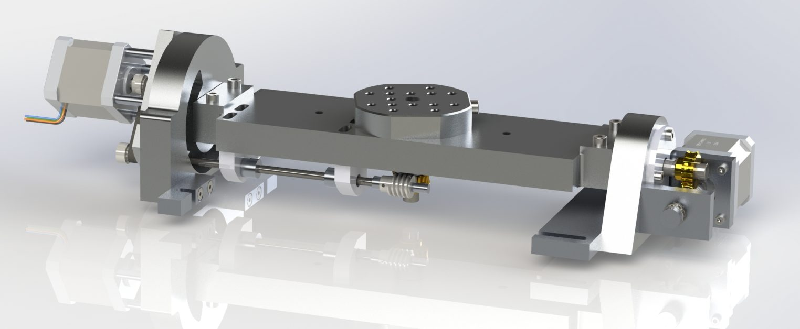

# AC/BC Rotary Table for 5-Axis CNC Extension

*Rotary table with two rotary axes – extends a DIY CNC router to 4- and 5-axis machining.*

Source: [AC/BC Tisch für 5-Achsen CNC Erweiterung (masdrive.ch, German)](https://masdrive.ch/myprojects/projects/ac-table/) · CAD: [Table for 5 Axis CNC with 2 Rotary Axis (GrabCAD)](https://grabcad.com/library/table-for-5-axis-cnc-with-2-rotary-axis-1)

This project extends my [self-built CNC router](../01-cnc-router/README.md) with a rotary table for 4- and 5-axis machining. The table can be used either as a single additional rotary axis or as a unit with two rotary axes in AC or BC configuration.

The goal was a compact and affordable solution that can be mounted on the existing CNC router when needed. It allows machining workpieces from several sides, producing positioned features, engraving cylindrical parts and gaining first experience with simultaneous multi-axis machining.

The project is deliberately meant as a DIY development platform. It is not a commercial series product but a continuously evolving concept for learning, testing and rebuilding.

## Concept and design

The rotary table was designed with readily available components and parts that can be made or adapted in a hobby workshop. The CAD models contain the relevant geometries and interfaces and should therefore always be used as the main reference for dimensions and assembly.

The design focused on:

- compact dimensions for use on a hobby CNC
- sufficient rigidity for light milling work
- modular use as a 4th axis or as a complete 5-axis table
- readily available components and simple construction
- straightforward integration into a multi-axis CNC controller

Depending on machine, spindle, tool and material, the rotary table of course reduces the available working space. Careful setup, collision checking and conservative cutting data are particularly important when using it.

For programming I am working on my own 5-axis CAM, [Mas5ACAM](https://github.com/mallemann/Mas5ACAM) ([project page](https://masdrive.ch/myprojects/projects/mas5acam/)).

## Use as a 4th axis

As a single rotary axis the table is particularly well suited for indexed machining. The workpiece can be rotated precisely between operations, so that several sides can be machined without manual re-clamping.

Typical applications:

- Drilling or milling features around a cylindrical workpiece
- Engraving round parts
- Making faces, holes or grooves at defined angles
- Machining small multi-sided parts
- Less setup effort for multiple machining orientations

If you only need a single rotary axis, my separate [4th CNC axis](../03-4th-axis/README.md) with 80 mm chuck is the simpler option.

## 5-axis configuration

With two rotary axes the workpiece can be rotated and tilted. This opens up additional possibilities, especially for parts with inclined faces or features that are hard to reach with a classic 3-axis router.

However, a 5-axis configuration requires much more preparation than conventional machining. CAM strategy, machine kinematics, post-processor and controller configuration must match the AC or BC arrangement used. **Before machining real workpieces, always test tool paths first in simulation and then above the workpiece without cutting.**

The additional axes are driven by the [6-axis CNC controller](../02-6-axis-controller/README.md) in my setup.

## CAD models

The CAD models contain the complete design and are the best starting point for anyone who wants to rebuild the table or adapt it to their own machine: [Table for 5 Axis CNC with 2 Rotary Axis (GrabCAD)](https://grabcad.com/library/table-for-5-axis-cnc-with-2-rotary-axis-1).

## The table in action

Videos on the [masdrive project page](https://masdrive.ch/myprojects/projects/ac-table/) show the rotary table in practical use. The prototype was built to explore and further develop the possibilities of multi-axis machining on a DIY CNC platform. The second, longer recording shows a complete machining run with both rotary axes.

## Notes for builders

Every CNC machine is different. Motorisation, gear ratios, drivers, controller parameters, limit switches and homing may need to be adapted to your own machine. Mechanical alignment and backlash adjustment also have a big influence on the final machining result.

This project is published as inspiration and for personal experiments.

---

*Translated from the German original on [masdrive.ch](https://masdrive.ch/myprojects/projects/ac-table/). Build at your own risk – see [DISCLAIMER](../../DISCLAIMER.md).*
