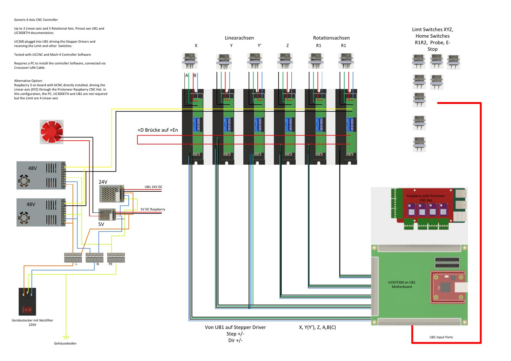

# Electronics

Schematic of the **Generic 6 Axis CNC Controller** used on the V4 router (German labels in the original).

- PDF: [v4-schematic-6-axis-controller.pdf](v4-schematic-6-axis-controller.pdf)
- Description of the controller: [docs/02-6-axis-controller](../docs/02-6-axis-controller/README.md)
- CAD of the enclosure: [Generic 6 Axis CNC / Robotics Controller (GrabCAD)](https://grabcad.com/library/generic-6-axis-cnc-robotics-controller-1)

## What the schematic shows

As noted on the schematic itself:

- Up to 3 linear axes and 3 rotational axes. For the pinout see the UB1 and UC300ETH documentation.
- The UC300 is plugged into the UB1, drives the stepper drivers (Step +/−, Dir +/−) and receives the limit and other switches on the UB1 input ports.
- Tested with UCCNC and Mach4 controller software.
- Requires a PC with the controller software, connected via crossover LAN cable.
- Power: mains inlet with line filter (220 V), two 48 V power supplies for the drivers, 24 V for the UB1, 5 V for the Raspberry Pi; enclosure base connected to PE.
- Inputs: limit switches XYZ, home switches of the rotary axes, probe, E-stop.
- **Alternative option:** a Raspberry Pi 3 on board with bCNC directly installed, driving the linear axes (XYZ) through the Protoneer Raspberry CNC HAT. In this configuration the PC, UC300ETH and UB1 are not required, but you are limited to 4 linear axes.

## Axis mapping (my machine)

| Channel | Axis | Function |
|---|---|---|
| 1 | X | Linear axis |
| 2 | Y | Linear axis, gantry side 1 |
| 3 | Y′ | Linear axis, gantry side 2 (runs synchronously with Y) |
| 4 | Z | Linear axis |
| 5 | A | Rotary axis of the AC table (or the single 4th axis) |
| 6 | C | Rotary axis of the AC table |

The schematic labels the rotary-axis outputs generically (R1 / "A, B(C)"); in my machine they are used as A and C. The two Y drives work synchronously on the gantry beam – this avoids racking but requires clean homing of both sides.

## Drivers and currents

- Up to 6 stepper motors, **max. 4.2 A per axis** (UC300ETH/UB1 controller).
- V4: NEMA 23 stepper motors with external **DQ542MA** drivers.
- V1/V3: A4988 or DRV8825 drivers on the Protoneer CNC HAT, 16 microsteps.

Set the motor current and microstepping on each driver to match **your** motors – the values above are limits and my choices, not recommendations.

## Safety

- **The emergency-stop chain must actually cut the power** to the drivers and the spindle. A software signal to the controller alone is not sufficient.
- Mains wiring (inlet, filter, power supplies, spindle drive) must be done by a qualified person; the enclosure must be earthed.
- Keep power and signal wiring separated; use shielded motor cables with the shield connected on one side.

See [DISCLAIMER.md](../DISCLAIMER.md).
